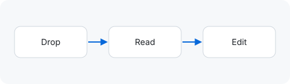

# Example documents

Open this folder in the workspace (or drag it onto the page) to try every feature. Each page below exercises a different part of the renderer.

| Document                                                      | What it shows                                        |
| ------------------------------------------------------------- | ---------------------------------------------------- |
| [Alerts and formatting](./alerts-and-formatting.md)           | GitHub alerts, tables, lists, emphasis               |
| [Math and diagrams](./math-and-diagrams.md#mermaid-flowchart) | KaTeX math and Mermaid diagrams                      |
| [Syntax highlighting](./syntax-highlighting.md)               | Code fences in many languages                        |
| [Sample data](./sample-data.json)                             | A plain-text file, shown read-only with highlighting |

## Relative images

Images resolve against this folder, just like on GitHub:

## Task lists

Click a checkbox to update the file — in a writable folder the change is saved right away.

- [x] Open a folder
- [ ] Edit a document and press <kbd>⌘</kbd> <kbd>S</kbd>
- [ ] Try split view for a live preview
  - [ ] Change a heading and watch the outline update

## Footnotes and links

Markdown files can link to each other[^links], and to headings within a page: [jump to task lists](#task-lists).

[^links]: Relative links open inside the workspace. External links open in a new tab.
