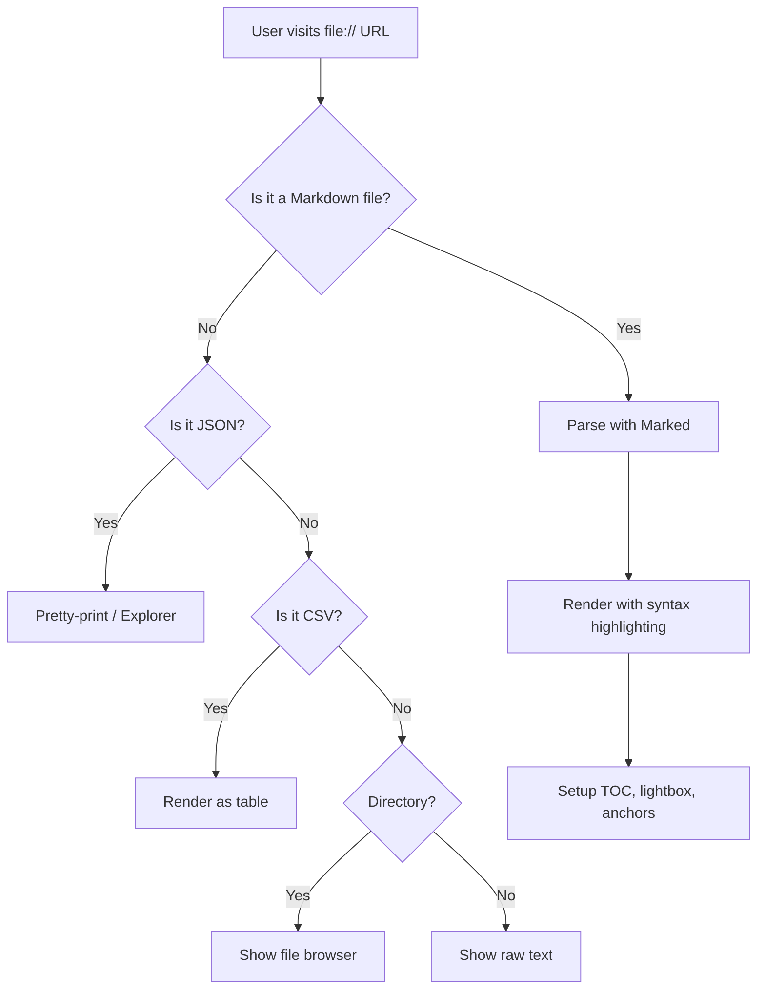
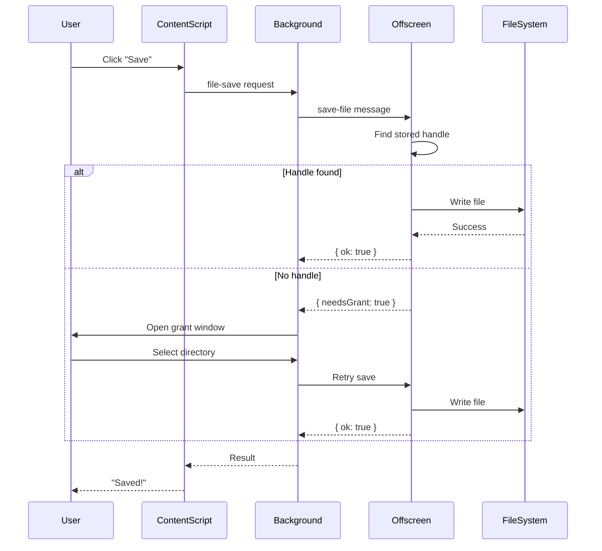
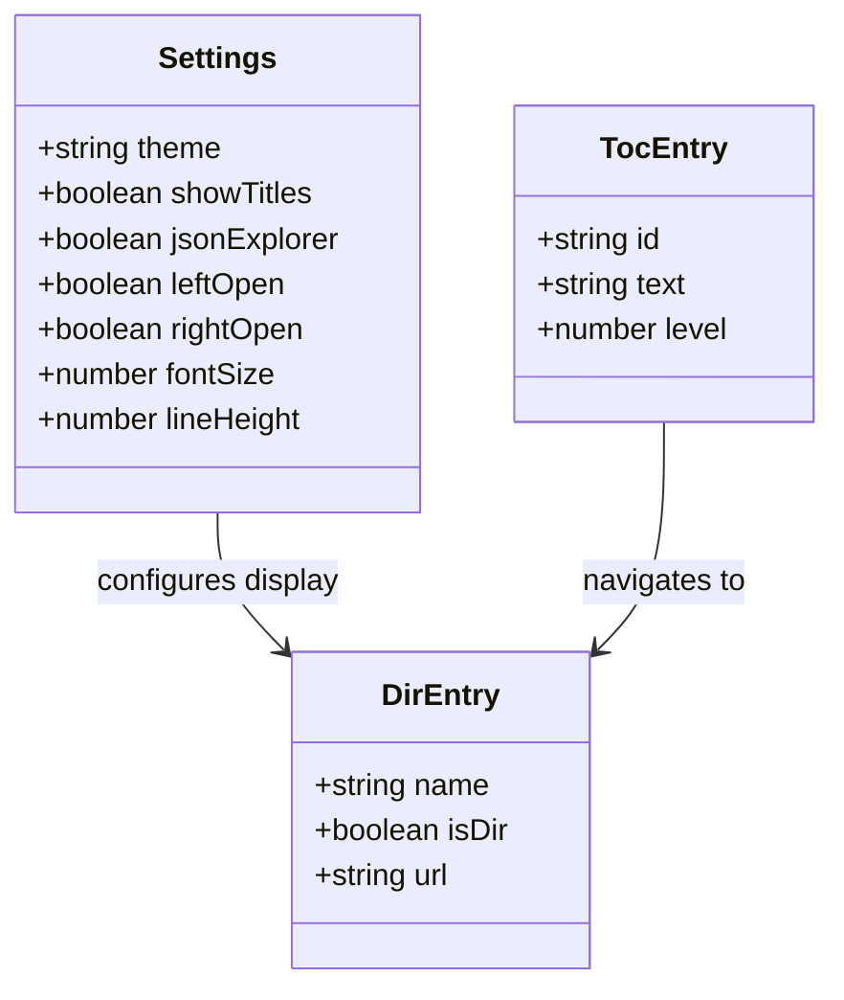

# Math & Diagrams Demo

## KaTeX Inline Math

Einstein's famous equation $E = mc^2$ changed physics forever. The quadratic formula $x = \frac{-b \pm \sqrt{b^2 - 4ac}}{2a}$ solves any second-degree polynomial equation.

In statistics, the standard deviation is $\sigma = \sqrt{\frac{1}{N}\sum_{i=1}^{N}(x_i - \mu)^2}$ where $\mu$ is the mean.

## KaTeX Display Math

The Fourier Transform:

$$F(\omega) = \int_{-\infty}^{\infty} f(t) \, e^{-i\omega t} \, dt$$

Euler's identity, often called the most beautiful equation in mathematics:

$$e^{i\pi} + 1 = 0$$

Maxwell's equations in differential form:

$$\nabla \cdot \mathbf{E} = \frac{\rho}{\epsilon_0}$$

$$\nabla \times \mathbf{B} = \mu_0 \mathbf{J} + \mu_0 \epsilon_0 \frac{\partial \mathbf{E}}{\partial t}$$

The Schrödinger equation:

$$i\hbar \frac{\partial}{\partial t} \Psi(\mathbf{r}, t) = \hat{H} \Psi(\mathbf{r}, t)$$

## Mermaid Flowchart

## Mermaid Sequence Diagram

## Mermaid Class Diagram

